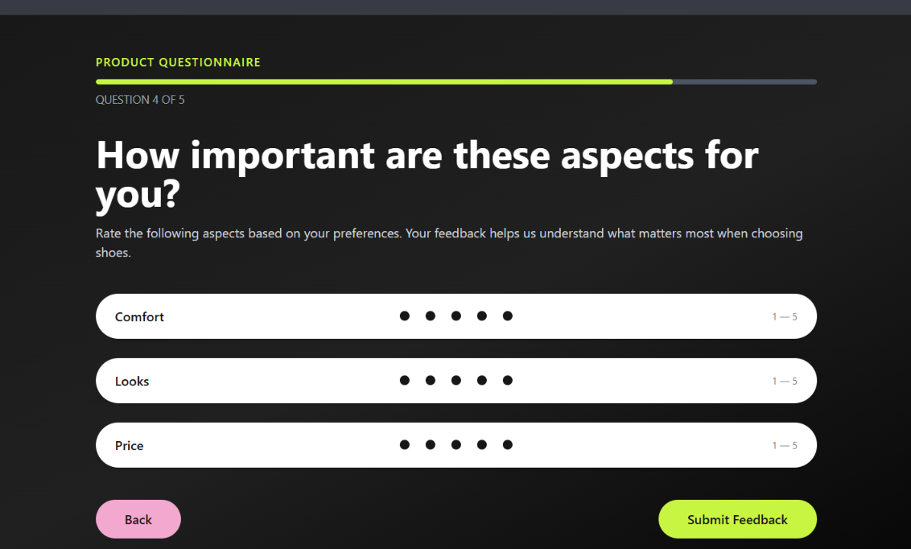
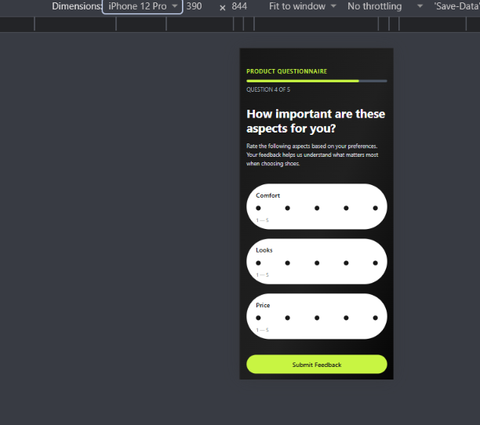

# Product Feedback Form

A responsive, accessible, multi-page product feedback application built with React, JavaScript, and Tailwind CSS.

## About the Project

This project is a product feedback questionnaire that allows users to rate different aspects of a product through an interactive form.

The application was extended to include multi-page navigation, shared state management, form validation, accessibility improvements, and performance optimisation.

## Features

- Responsive design for mobile, tablet, and desktop.
- Interactive 1–5 rating selection.
- Form validation with helpful error messages.
- Success and error feedback after submission.
- Reset functionality to submit another response.
- Multi-page navigation with active link highlighting.
- Dynamic item details using URL parameters.
- Custom 404 page for unknown routes.
- Shared state between components.
- Form data managed using React's `useReducer`.
- Lazy-loaded page components.
- Keyboard-accessible rating controls.
- Skip-to-main-content navigation link.
- Visible keyboard focus indicators.

## Application Routes

| Route | Description |
|---|---|
| `/` | Home page |
| `/form` | Product feedback form |
| `/thank-you` | Thank-you page |
| `/items/:itemId` | Dynamic item details |
| `*` | 404 Not Found page |

## Technologies Used

- React
- JavaScript
- Tailwind CSS
- Vite
- React Router DOM
- Git and GitHub

## Accessibility Improvements

The application includes:

- Keyboard navigation using Tab and Enter.
- Visible focus indicators.
- Skip-to-main-content links.
- Semantic HTML landmarks.
- Accessible rating groups and labels.
- Form validation messages.
- Appropriate status and alert messages.

Accessibility was checked using Lighthouse and manual keyboard testing.

## Performance Optimisation

Implemented lazy loading for route components using React's `lazy()` and `Suspense`.

This allows page components to load when needed instead of loading every page component immediately.

The production build was tested using Lighthouse.

## Lighthouse Audit Results

| Category | Development audit | Production audit |
|---|---:|---:|
| Performance | 60 | 98 |
| Accessibility | 100 | 100 |
| Best Practices | 100 | 100 |
| SEO | 82 | 100 |

**Important:** The initial audit was performed on the Vite development server, while the later audit was performed on the production preview. These results are not a strictly controlled before-and-after comparison.

### Production Performance Metrics

| Metric | Result |
|---|---:|
| First Contentful Paint (FCP) | 0.8 s |
| Largest Contentful Paint (LCP) | 0.9 s |
| Total Blocking Time (TBT) | 40 ms |
| Cumulative Layout Shift (CLS) | 0.001 |
| Speed Index | 1.0 s |

### SEO Improvements

- Added a meta description to `index.html`.
- Added a valid `robots.txt` file inside the `public` folder.

### Audit Evidence

Lighthouse reports are saved in the `screenshots` folder:

- `lighthouse-before.pdf`
- `lighthouse-after.pdf`

## Getting Started

To run this project locally:

1. Clone the repository:

   ```bash
   git clone https://github.com/afoyorwoth/product-feedback-form.git
   ```

2. Open the project folder:

   ```bash
   cd product-feedback-form
   ```

3. Install dependencies:

   ```bash
   npm install
   ```

4. Start the development server:

   ```bash
   npm run dev
   ```

5. Open the local URL provided in your terminal.

To create and preview a production build:

```bash
npm run build
npm run preview
```

## Screenshots

### Desktop View



### Mobile View



## What I Learned

Through this project, I practised:

- Building reusable React components.
- Managing form data using `useReducer`.
- Sharing state between sibling components.
- Implementing multi-page navigation with React Router.
- Creating dynamic routes using URL parameters.
- Implementing form validation.
- Improving accessibility and keyboard navigation.
- Optimising page loading with lazy loading.
- Running Lighthouse audits and interpreting performance metrics.
- Documenting development and testing results.

## Limitations and Future Improvements

- Connect the form to a backend to store submitted feedback.
- Improve performance further by investigating remaining JavaScript optimisation opportunities.
- Conduct additional accessibility testing with assistive technologies.
- Deploy the updated multi-page application.

## Author

**Afoyorwoth Patricia**

[GitHub Profile](https://github.com/afoyorwoth)

---

*Built as part of my frontend development learning journey.*
